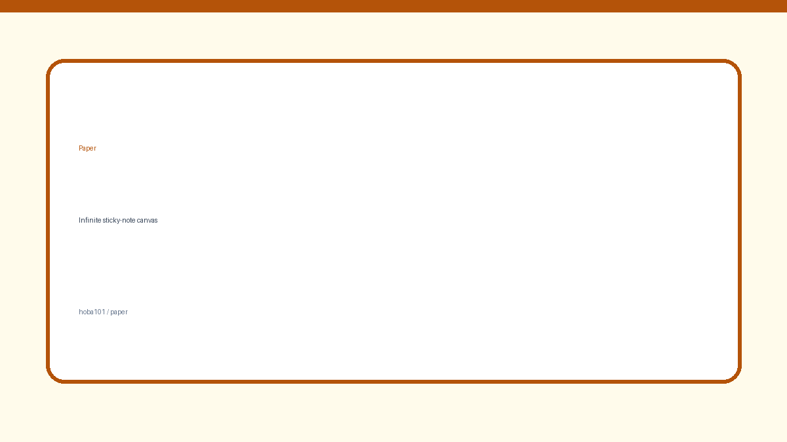

# 📝 Paper — Infinite Sticky-Note Canvas

A tiny, dependency-free web app that turns your browser into an endless corkboard. Drop papers anywhere, write notes, attach images, resize, rotate, and pan around an infinite canvas — then share the whole board with a 5-character code.

**Live demo:** https://hoba101.github.io/Paper/



## ✨ Features

- **Infinite canvas** — pan with drag (with momentum), zoom with the mouse wheel or a two-finger pinch.
- **Rich notes** — text, images, background images, custom colours, five font styles, and three paper shapes (square, rounded, polaroid).
- **Direct manipulation** — drag papers around, resize with the corner handle, rotate with the handle or right-click drag.
- **Share boards** — generate a short code backed by Firebase Realtime Database and load a friend's layout instantly.
- **Autosave** — every change is saved to `localStorage`, so your board survives a refresh.
- **Custom backdrop** — set any image as the canvas background.

## 🛠️ Tech

- Vanilla HTML / CSS / JavaScript (no build step)
- [Firebase Realtime Database](https://firebase.google.com/docs/database) for board sharing
- GitHub Pages for hosting

## 🚀 Run locally

Because the app is fully static, any static server works:

```bash
git clone https://github.com/hoba101/Paper.git
cd Paper
python3 -m http.server 8080
```

Open <http://localhost:8080>.

> Sharing boards needs a Firebase project. Create a Realtime Database and paste your web config into the `firebaseConfig` object at the top of `script.js`. Local editing and autosave work without Firebase.

## 🔐 Firebase notes

The web config in `script.js` is a **public** Firebase config (that is how the Firebase web SDK works). Security comes from the database rules, not from hiding the key. Recommended setup:

- Set database rules so only `boards/*` can be written/read, and never store personal data there.
- Restrict the API key in Google Cloud Console to your GitHub Pages domain(s).
- Boards are only reachable by their random 5-character code — treat the code as a share link.

## 📁 Project structure

```
Paper/
├── index.html      # Markup: canvas, modals, FABs
├── style.css       # Paper, canvas and modal styles
├── script.js       # Canvas engine, Paper class, sync + persistence
├── images/         # Static images used by the demo
└── .github/        # GitHub Pages deployment workflow
```

## 📄 License

[MIT](LICENSE) © 2026 Miro (Ehab)
